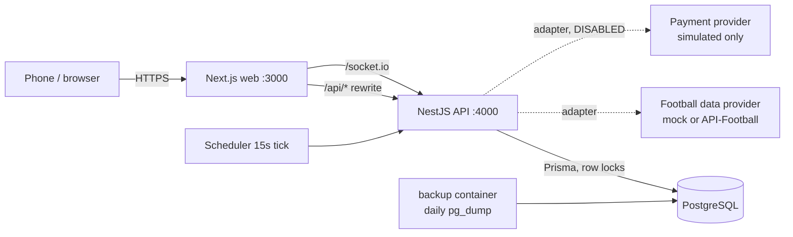
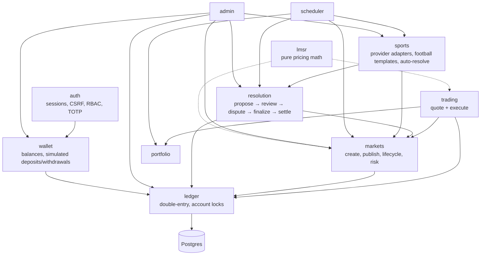
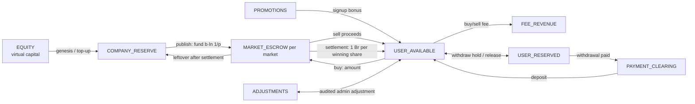
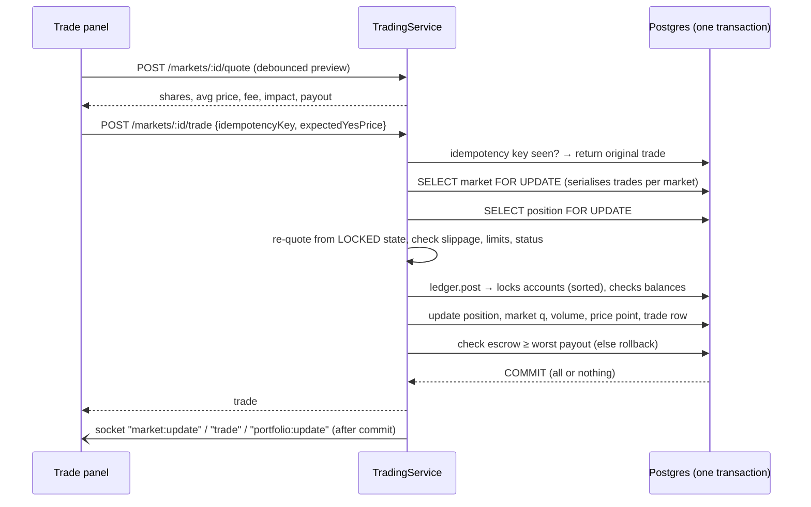
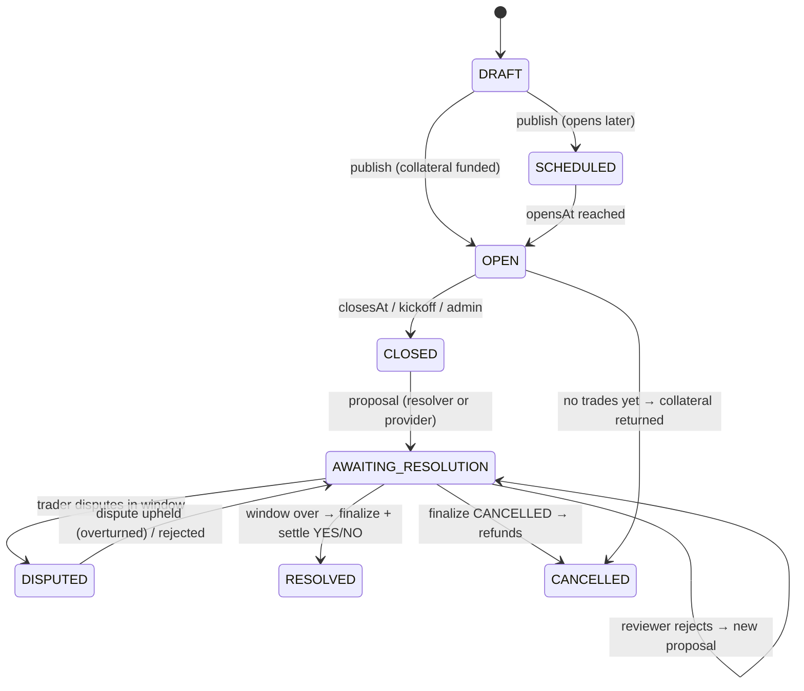
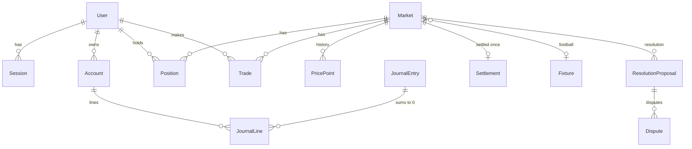

# Tinbit architecture

Tinbit (ትንቢት, "prophecy") is a YES/NO prediction market for Ethiopian and international events,
running on **virtual birr**. It is built to be cheap and simple to run for a small team:

| Piece | Choice | Why (for a beginner startup) |
|---|---|---|
| Web | Next.js 15 (App Router), Tailwind v4, SWR, socket.io-client | One small app, mobile-first, ~130–150 kB first load |
| API | NestJS 11 modular monolith | One deployable; modules can be split later if ever needed |
| DB | PostgreSQL 16 + Prisma 6 | The database is the source of truth for money; constraints & triggers enforce invariants |
| Real-time | Socket.IO inside the API | No extra service. Events are hints; clients re-fetch from the API |
| Jobs | In-process scheduler (`@nestjs/schedule`) | Replaces BullMQ/Redis for now — every job is idempotent and row-locked, so it is safe to move to a queue later |
| Money math | `decimal.js` (40 significant digits), `NUMERIC` columns | No JS floats anywhere near balances |

> **Deliberate simplification:** the original brief asked for Redis + BullMQ. At Tinbit's size they add a
> service to run, monitor and pay for without adding safety (the DB already serialises trades). Add
> Redis when you run >1 API instance (Socket.IO adapter + shared rate-limit store) — see "Scaling" below.

## System

## API modules (`src/`)

Generated file-level map: [`docs/graph/CODEMAP.md`](graph/CODEMAP.md) (`pnpm codemap` to refresh).

## Where money lives (ledger accounts)

Every movement is a balanced `JournalEntry` (lines sum to 0 — enforced by a deferred DB trigger).

Customer funds (`USER_*`), per-market escrow, company reserve and fee revenue are separate accounts,
so the admin overview can always answer "whose money is this?".

**Solvency invariant** (checked inside every trade transaction and by reconciliation):
`escrow ≥ max(outstanding YES shares, outstanding NO shares)`. It always holds because the escrow is
pre-funded with the LMSR worst-case loss and rounding always favours the pool.

## A trade, step by step

Duplicate clicks or network retries reuse the same `idempotencyKey` → the unique index
`Trade(userId, idempotencyKey)` guarantees exactly-once execution.

## Market lifecycle & resolution

Rules enforced in `resolution.service.ts`:
- **Four-eyes:** the reviewer must be a different person from the proposer (also for disputes).
- **Dispute window** per market (`disputeHours`); only traders in that market may dispute.
- **Settle exactly once:** market row lock + `Settlement.marketId UNIQUE` + status check.
- **Cancellation** (`cancellationPolicy`): `REFUND_NET_COST` — each trader gets back
  max(0, Σbuys − Σsells) excl. fees (pro-rata if the pool can't cover); or `LAST_PRICE` — shares pay the
  pre-close price. Naive "refund what you paid" is wrong after resales; both policies are solvent.
- **Football:** trading closes at kickoff; finished matches with a regular-time score are auto-proposed and
  auto-confirmed (dispute window still applies); cancelled/abandoned/long-postponed or inconsistent data
  produce a proposal that **requires human review**.

## Data model (core)

DB-level guarantees (see `prisma/migrations/*_init/migration.sql`): non-negative customer/escrow balances
and positions, balanced journal entries, append-only `JournalEntry`/`JournalLine`/`AuditLog`, price and
probability bounds.

## Real-time

Socket.IO rooms: `markets` (all public updates), `market:<id>`, `user:<id>` (joined from the session cookie).
Events are only emitted **after commit** and clients respond by re-fetching via SWR, so a dropped or
duplicated event can never show a wrong balance.

## Scaling path (when you need it)

1. Second API instance → add `@socket.io/redis-adapter` + a Redis throttler store.
2. Heavy jobs → move `SchedulerService.runAll` steps to BullMQ workers (they are already idempotent).
3. Read load → cache `/markets/home` for a few seconds (CDN or Redis).
4. Limit orders → new `Order` table matched against the AMM; the AMM/ledger code does not change.
