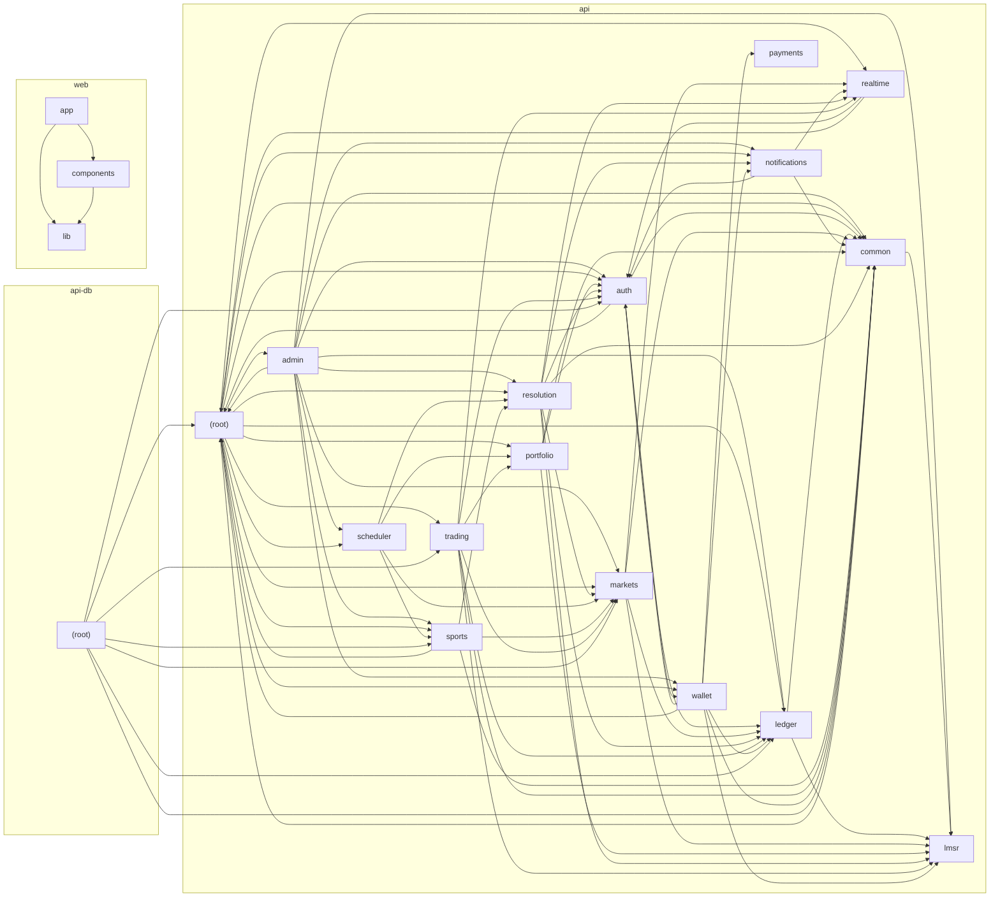

# Code map

_Generated by `node scripts/codemap.mjs` — do not edit by hand._

95 files · 336 import edges · 20 modules

## Module dependencies

## Files

### api-db/(root)

| File | Lines | Exports | What it does |
|---|---:|---|---|
| `prediction-market-backend/prisma/seed.ts` | 156 |  | Seed: system accounts, staff/demo users and DEMONSTRATION markets. Everything below is invented demo data and is labelled isDemo=true. Demo trading history is produced by running real trades through the TradingService (w |

### api-test/(root)

| File | Lines | Exports | What it does |
|---|---:|---|---|
| `prediction-market-backend/test/helpers.ts` | 146 | Ctx, setup, reset, user, market, balance | Resolve a market through the full workflow (propose → review → window → finalize). |
| `prediction-market-backend/test/setup-env.ts` | 8 |  |  |

### api-test/integration

| File | Lines | Exports | What it does |
|---|---:|---|---|
| `prediction-market-backend/test/integration/api.spec.ts` | 154 |  |  |
| `prediction-market-backend/test/integration/critical-scenario.spec.ts` | 119 |  | The acceptance scenario from the spec: 50/50 market (b = 1000, no fee) → User A spends 1,000 on YES → User B spends 20 on NO. Every expected number is derived here from the LMSR closed form, independently of the engine,  |
| `prediction-market-backend/test/integration/resolution.spec.ts` | 182 |  | no market can be settled twice |
| `prediction-market-backend/test/integration/trading.spec.ts` | 166 |  | round trip loses only fees (+ rounding dust), never gains |

### api-test/unit

| File | Lines | Exports | What it does |
|---|---:|---|---|
| `prediction-market-backend/test/unit/lmsr.spec.ts` | 136 |  | simulate a whale buying almost all YES: loss approaches but never exceeds the bound |

### api/(root)

| File | Lines | Exports | What it does |
|---|---:|---|---|
| `prediction-market-backend/src/app.module.ts` | 55 | AppModule | Liveness + DB readiness (used by Docker health checks). |
| `prediction-market-backend/src/config.ts` | 42 | Config, config, blockedCountries |  |
| `prediction-market-backend/src/main.ts` | 30 | createApp |  |

### api/admin

| File | Lines | Exports | What it does |
|---|---:|---|---|
| `prediction-market-backend/src/admin/admin.controller.ts` | 171 | AdminController | ── markets ── |
| `prediction-market-backend/src/admin/admin.module.ts` | 12 | AdminModule |  |
| `prediction-market-backend/src/admin/admin.service.ts` | 194 | AdminService | Market-maker risk across all funded, unsettled markets. |

### api/auth

| File | Lines | Exports | What it does |
|---|---:|---|---|
| `prediction-market-backend/src/auth/auth.controller.ts` | 98 | AuthController |  |
| `prediction-market-backend/src/auth/auth.guard.ts` | 34 | AuthGuard, Auth, CurrentUser, ClientIp | Require a logged-in user, optionally with a permission. |
| `prediction-market-backend/src/auth/auth.module.ts` | 18 | AuthModule |  |
| `prediction-market-backend/src/auth/auth.service.ts` | 168 | registerSchema, loginSchema, AuthService, ageOn | virtual issuance from the promotions account (its negative balance = total bonuses issued) |
| `prediction-market-backend/src/auth/auth.types.ts` | 38 | AuthUser, AuthedRequest, SESSION_COOKIE, CSRF_COOKIE, CSRF_HEADER, PERMISSIONS | What each role is allowed to do. ADMIN implies everything. |
| `prediction-market-backend/src/auth/session.middleware.ts` | 42 | SessionMiddleware | 1. Resolves the session cookie into req.user. 2. Double-submit CSRF protection: mutating requests must echo the tb_csrf cookie in the X-CSRF-Token header (SameSite=Lax cookies + this header defeat CSRF). |

### api/common

| File | Lines | Exports | What it does |
|---|---:|---|---|
| `prediction-market-backend/src/common/audit.service.ts` | 34 | AuditInput, AuditService | Append-only audit trail (DB trigger forbids UPDATE/DELETE on AuditLog). |
| `prediction-market-backend/src/common/clock.service.ts` | 45 | ClockService | Single source of "now" for business rules (market open/close, dispute windows). In DEMO_MODE an admin can shift it forward to simulate the passage of time. |
| `prediction-market-backend/src/common/common.module.ts` | 12 | CommonModule |  |
| `prediction-market-backend/src/common/errors.ts` | 40 | DomainError, notFound, forbidden, conflict, AllExceptionsFilter | A business-rule violation with a user-facing message. |
| `prediction-market-backend/src/common/money.ts` | 8 | toDec, money, shares, ZERO |  |
| `prediction-market-backend/src/common/prisma.service.ts` | 44 | Tx, PrismaService | Run `fn` in a single atomic DB transaction. Retries on serialization failures / deadlocks, so callers must make `fn` free of external side effects. |
| `prediction-market-backend/src/common/throttler.guard.ts` | 16 | AppThrottlerGuard | Rate-limit key = client IP + targeted account (for login/register). Brute force against one account stays capped, while many people behind one NAT (common on mobile networks) are not locked out by each other. |
| `prediction-market-backend/src/common/validate.ts` | 24 | parse, decimalString, idempotencyKey, rate | Decimal string with up to `dp` places — never a JS float. |

### api/ledger

| File | Lines | Exports | What it does |
|---|---:|---|---|
| `prediction-market-backend/src/ledger/ledger.module.ts` | 7 | LedgerModule |  |
| `prediction-market-backend/src/ledger/ledger.service.ts` | 142 | LineInput, PostInput, LedgerService | Double-entry ledger. All balance changes go through `post`, inside the caller's transaction. Accounts are row-locked (in id order, to avoid deadlocks) before any balance is read or written. |

### api/lmsr

| File | Lines | Exports | What it does |
|---|---:|---|---|
| `prediction-market-backend/src/lmsr/lmsr.ts` | 144 | D, Dec, DecLike, SHARE_DP, MONEY_DP, dec | Logarithmic Market Scoring Rule (LMSR) for binary YES/NO markets. C(qY, qN) = b · ln(e^(qY/b) + e^(qN/b)) p_YES = ∂C/∂qY = e^(qY/b) / (e^(qY/b) + e^(qN/b)) = 1 / (1 + e^((qN − qY)/b)) Pure functions on decimal.js values  |
| `prediction-market-backend/src/lmsr/quote.ts` | 132 | TradeSide, QuoteMode, QuoteRequest, Quote, QuoteError, MIN_TRADE | Turns an LMSR state + a trade request into an exact, rounded execution plan. Rounding always favours the market's solvency (never the trader, never the house's books in a way that could break the escrow invariant): - buy |

### api/markets

| File | Lines | Exports | What it does |
|---|---:|---|---|
| `prediction-market-backend/src/markets/markets.controller.ts` | 50 | MarketsController | Everything the homepage needs in one request. |
| `prediction-market-backend/src/markets/markets.module.ts` | 7 | MarketsModule |  |
| `prediction-market-backend/src/markets/markets.service.ts` | 428 | CATEGORIES, createMarketSchema, updateMarketSchema, stateOf, MarketsService | Market-maker economics for one market (all derived from authoritative state). |

### api/notifications

| File | Lines | Exports | What it does |
|---|---:|---|---|
| `prediction-market-backend/src/notifications/notifications.controller.ts` | 23 | NotificationsController |  |
| `prediction-market-backend/src/notifications/notifications.module.ts` | 8 | NotificationsModule |  |
| `prediction-market-backend/src/notifications/notifications.service.ts` | 54 | NotifyInput, NotificationsService | Push already-committed notifications to sockets (used after a transaction). |

### api/payments

| File | Lines | Exports | What it does |
|---|---:|---|---|
| `prediction-market-backend/src/payments/payment-provider.ts` | 68 | ProviderDepositInit, ProviderWebhookEvent, PaymentProvider, SimulatedPaymentProvider, DisabledPaymentProvider, screenPayment | Payment provider abstraction. Only a SIMULATED provider ships with Tinbit. Real-money providers (e.g. a licensed Ethiopian mobile-money or bank gateway) must implement this interface AND pass legal/regulatory approval +  |

### api/portfolio

| File | Lines | Exports | What it does |
|---|---:|---|---|
| `prediction-market-backend/src/portfolio/portfolio.controller.ts` | 23 | PortfolioController |  |
| `prediction-market-backend/src/portfolio/portfolio.module.ts` | 8 | PortfolioModule |  |
| `prediction-market-backend/src/portfolio/portfolio.service.ts` | 101 | PortfolioService | Mark-to-market a position at the current marginal price (or the final outcome). |

### api/realtime

| File | Lines | Exports | What it does |
|---|---:|---|---|
| `prediction-market-backend/src/realtime/cookie.ts` | 11 | parse |  |
| `prediction-market-backend/src/realtime/realtime.gateway.ts` | 57 | RealtimeGateway | Live updates over Socket.IO. The database stays authoritative: every event is emitted only AFTER the transaction that produced it has committed, and clients re-fetch from the API when they (re)connect. rooms: market:<id> |
| `prediction-market-backend/src/realtime/realtime.module.ts` | 8 | RealtimeModule |  |

### api/resolution

| File | Lines | Exports | What it does |
|---|---:|---|---|
| `prediction-market-backend/src/resolution/resolution.controller.ts` | 20 | ResolutionController | Any trader in the market can dispute a confirmed result during the dispute window. |
| `prediction-market-backend/src/resolution/resolution.module.ts` | 8 | ResolutionModule |  |
| `prediction-market-backend/src/resolution/resolution.service.ts` | 307 | ProposeInput, ResolutionService | Resolution workflow: propose (resolver / automated provider) → review by a DIFFERENT reviewer → dispute window → (optional) disputes resolved by a reviewer/admin → finalize → settle (exactly once). |

### api/scheduler

| File | Lines | Exports | What it does |
|---|---:|---|---|
| `prediction-market-backend/src/scheduler/scheduler.module.ts` | 9 | SchedulerModule |  |
| `prediction-market-backend/src/scheduler/scheduler.service.ts` | 51 | SchedulerService | In-process scheduler (instead of BullMQ+Redis) — one less service to run while Tinbit is small. Every job is idempotent and DB-locked, so running two API instances is still safe; move to a queue when there are many insta |

### api/sports

| File | Lines | Exports | What it does |
|---|---:|---|---|
| `prediction-market-backend/src/sports/api-football.provider.ts` | 60 | ApiFootballProvider | Adapter for API-Football (api-sports.io). Requires API_FOOTBALL_KEY. NOT exercised in CI (no credentials). League ids should be confirmed against the provider's /leagues endpoint before going live — especially the Ethiop |
| `prediction-market-backend/src/sports/mock.provider.ts` | 43 | MockFootballProvider | DEMONSTRATION DATA ONLY. These fixtures are invented and are not real scheduled matches. Results are set by an administrator in demo mode (Admin → Sports → "Set demo result"). |
| `prediction-market-backend/src/sports/provider.ts` | 30 | ProviderFixture, League, LEAGUES, FootballProvider | Normalised fixture shape every football data adapter must return. |
| `prediction-market-backend/src/sports/sports.module.ts` | 8 | SportsModule |  |
| `prediction-market-backend/src/sports/sports.service.ts` | 199 | FOOTBALL_TYPES, footballOutcome, SportsService | Create the standard football markets for a fixture. Trading closes at kickoff (no in-play). |

### api/trading

| File | Lines | Exports | What it does |
|---|---:|---|---|
| `prediction-market-backend/src/trading/trading.controller.ts` | 27 | TradingController |  |
| `prediction-market-backend/src/trading/trading.module.ts` | 8 | TradingModule |  |
| `prediction-market-backend/src/trading/trading.service.ts` | 239 | quoteSchema, tradeSchema, TradeInput, TradingService | Slippage guard: reject if the YES price moved beyond this many probability points from the preview (default 5 pts). |

### api/wallet

| File | Lines | Exports | What it does |
|---|---:|---|---|
| `prediction-market-backend/src/wallet/wallet.controller.ts` | 51 | WalletController | Future: real provider confirmations land here (signature verified by the provider adapter). |
| `prediction-market-backend/src/wallet/wallet.module.ts` | 7 | WalletModule |  |
| `prediction-market-backend/src/wallet/wallet.service.ts` | 173 | WalletService | Simulated deposit: intent → provider → confirmation (as a webhook would) → ledger credit. |

### web/app

| File | Lines | Exports | What it does |
|---|---:|---|---|
| `prediction-market-frontend/src/app/admin/markets/[id]/page.tsx` | 89 | AdminMarket |  |
| `prediction-market-frontend/src/app/admin/page.tsx` | 354 | AdminPage |  |
| `prediction-market-frontend/src/app/how-it-works/page.tsx` | 96 | HowItWorks | Float math is fine here: this is an illustration only. Real trades are priced on the server |
| `prediction-market-frontend/src/app/layout.tsx` | 34 | metadata, viewport, RootLayout |  |
| `prediction-market-frontend/src/app/login/page.tsx` | 51 | LoginPage |  |
| `prediction-market-frontend/src/app/markets/[slug]/page.tsx` | 199 | MarketPage | live: any trade/status change on this market → refetch authoritative state |
| `prediction-market-frontend/src/app/markets/page.tsx` | 46 | MarketsPage |  |
| `prediction-market-frontend/src/app/notifications/page.tsx` | 43 | NotificationsPage |  |
| `prediction-market-frontend/src/app/page.tsx` | 54 | HomePage |  |
| `prediction-market-frontend/src/app/portfolio/page.tsx` | 193 | PortfolioPage |  |
| `prediction-market-frontend/src/app/providers.tsx` | 22 | Providers |  |
| `prediction-market-frontend/src/app/register/page.tsx` | 57 | RegisterPage |  |
| `prediction-market-frontend/src/app/settings/page.tsx` | 55 | SettingsPage |  |

### web/components

| File | Lines | Exports | What it does |
|---|---:|---|---|
| `prediction-market-frontend/src/components/admin/create-market.tsx` | 87 | CreateMarket |  |
| `prediction-market-frontend/src/components/admin/shared.tsx` | 46 | useAction, Table, Td, KPI |  |
| `prediction-market-frontend/src/components/auth-shell.tsx` | 14 | AuthShell |  |
| `prediction-market-frontend/src/components/categories.tsx` | 26 | CATS, CategoryChips |  |
| `prediction-market-frontend/src/components/chart.tsx` | 78 | Pt, LineChart | Lightweight SVG line/area chart with hover crosshair (no chart library = small bundle). |
| `prediction-market-frontend/src/components/footer.tsx` | 20 | Footer |  |
| `prediction-market-frontend/src/components/logo.tsx` | 14 | Logo |  |
| `prediction-market-frontend/src/components/market-card.tsx` | 68 | MarketCard, MarketCardSkeleton |  |
| `prediction-market-frontend/src/components/nav.tsx` | 124 | Nav |  |
| `prediction-market-frontend/src/components/section.tsx` | 21 | Section |  |
| `prediction-market-frontend/src/components/status-badge.tsx` | 8 | StatusBadge |  |
| `prediction-market-frontend/src/components/trade-panel.tsx` | 224 | TradePanel | new idempotency key whenever the intended trade changes |
| `prediction-market-frontend/src/components/ui/primitives.tsx` | 139 | Button, Input, Textarea, Select, Label, Card |  |
| `prediction-market-frontend/src/components/ui/toast.tsx` | 30 | ToastProvider, useToast |  |

### web/lib

| File | Lines | Exports | What it does |
|---|---:|---|---|
| `prediction-market-frontend/src/lib/api.ts` | 37 | ApiError, api, fetcher |  |
| `prediction-market-frontend/src/lib/format.ts` | 42 | birr, pct, cents, num, signed, timeLeft |  |
| `prediction-market-frontend/src/lib/i18n.tsx` | 86 | Locale, I18nProvider, useI18n, useLocalized | Pick the Amharic text when available and selected. |
| `prediction-market-frontend/src/lib/realtime.tsx` | 58 | RealtimeProvider, useSocketEvent, useLivePrice | One Socket.IO connection per tab. Events are hints: on every event we revalidate the relevant SWR keys so the API (database) stays the source of truth. |
| `prediction-market-frontend/src/lib/session.tsx` | 23 | useMe |  |
| `prediction-market-frontend/src/lib/types.ts` | 145 | Status, Market, Liquidity, TradeRow, Proposal, MarketDetail |  |
| `prediction-market-frontend/src/lib/utils.ts` | 5 | cn, uid |  |

